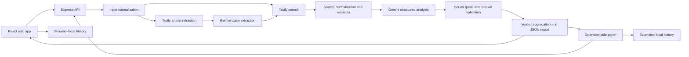

# CUDA AI — production-readiness audit

Audit date: **21 November 2026, Asia/Calcutta**. Scope: the current local working tree on `feat/working-fact-checker`, based on commit `eed4a75`, including its existing uncommitted improvements. This is an audit and proposal, not approval to implement Phase 0.

## Assessment

The project is a working evidence-grounded demo with meaningful safeguards. Server-owned source IDs, normalized quote checks, excerpt selection, explicit abstention, private browser history, provider timeouts/fallbacks, and basic CI are worth preserving. The architecture is small enough to improve incrementally without replacing the product.

It is not yet production-ready or a reproducibly evaluated fact-checker. Passing tests and a quote that occurs in a source do not establish factual correctness, source independence, or calibrated confidence. There are also two concrete contract/cancellation defects, incomplete runtime schema enforcement, and a broken documented offline-demo path.

**No application source was changed during this audit.** Audit scripts and reports were added under `docs/audit/`. Existing source changes remain separate. The empty-article regression below originated in the previous history-validation improvement and is deliberately left for the next approved phase.

## Stack and repository structure

| Area | Current implementation | Implication |
| --- | --- | --- |
| Runtime/build | Node.js, npm workspaces, Vite; runtime tested with Node `v22.23.2` | A conventional JavaScript stack; no strict TypeScript boundary yet. |
| Web | React, JSX, lucide-react, global CSS | Dark dashboard with claim/article entry, results, history, statistics, copy/export, cancellation, and service panels. |
| API | Express and express-rate-limit | Local adapter in `backend/api/index.js`; implementation lives in `frontend/client/server/` for existing Vercel root-directory support. |
| Providers | Gemini generation/vision, Tavily search/extract, optional Google evidence | Injected `search`, `extract`, `generate` methods and injectable transport already support offline tests. Interfaces are informal JavaScript objects. |
| Validation | Provider JSON schema plus hand-written server/browser validators | No shared, executable contract; validators can diverge and omit required fields. |
| History | Browser localStorage; extension chrome.storage.local | Privacy-friendly default, with separate web and extension implementations. No server database or migrations. |
| Extension | Manifest V3 service worker, side panel, content-script bridge, context menu | Selected-text, right-click, and reviewed screenshot workflows already exist. No inline page result or result permalink. |
| Testing | node:test; provider/HTTP/storage fixtures | Tests, lint, build and npm dependency audit configured in GitHub Actions. Coverage thresholds and browser/evaluation/security contract gates are absent. |
| Deployment | Vercel adapters/configuration and local Node startup | No Dockerfile, Compose stack, infrastructure environments, or verified rollback/load-test report. |

The declared dependencies include React, React DOM, Express, dotenv, express-rate-limit, and lucide-react, with Vite/ESLint tooling. Backend dependencies currently belong to the frontend workspace because runtime sources are located there. That coupling should be removed carefully while preserving adapters until the deployment choice is confirmed.

There is no `apps/` and `packages/shared/` layout, strict typing configuration, `.editorconfig`, formatter policy, pre-commit setup, OpenAPI specification, database migrations, maintained source-quality configuration, or versioned pipeline trace. Two CSS files define overlapping global tokens and component styles; adapters and configuration exist in several locations.

## Architecture and data flow



For a claim, the API validates text and uses the claim itself as a search query, truncated by the provider adapter. For an article, Tavily extracts text and Gemini selects key claims before separate searches. Sources are capped, basic URL safety checked, exact URL duplicates removed, and the article publisher excluded. The model receives JSON data and an instruction identifying retrieved material as untrusted. Citations are resolved to registered source excerpts, checked against normalized source text, and invalid evidence is discarded. A failed definitive finding can receive a repair attempt against the same evidence. Findings are aggregated and returned as a single JSON response.

Web history is not stored server-side. Screenshot capture remains local until the extension user clicks the reading action; Gemini receives the screenshot, and later claim verification uses the same API. The extension keeps its own local text-report history. Prompt separation and text-safe rendering exist; they need adversarial and cross-context tests rather than an assumption of immunity.

## Reproduced baseline

These are observations from scripts, not claimed production performance or fact-check accuracy. Re-run from the repository root:

```sh
node docs/audit/verify.cjs
node docs/audit/probes.cjs
node docs/audit/secret-scan.cjs
npm audit --json
```

| Check | Observed result | Evidence |
| --- | --- | --- |
| Existing test/lint/build command | Passed; **43 tests, 43 passed, 0 failed** | `docs/audit/quality-results.json`, `check.txt` |
| Core server coverage | **88.09% lines, 83.90% branches, 89.39% functions** | `coverage.txt`; include filter `frontend/client/server/*.js` |
| Configuration coverage | **12.12% lines** | `coverage.txt`; aggregate coverage masks this weak area. |
| Provider coverage | **77.65% lines** | `coverage.txt`; Google paths and several failure/response branches remain uncovered. |
| Empty article | API returns Unverified with an empty claim list; browser validator rejects it | `probe-results.json: empty_article` |
| Client cancellation | Simulated upstream work completed; its signal was not aborted | `probe-results.json: client_disconnect` |
| Missing required claim classification | Runtime validator accepted a definitive response without `claim_kind` | `probe-results.json: missing_required_claim_kind` |
| Single-source finding | A definitive result remained valid with one publisher | `probe-results.json: single_source` |
| URL normalization | Tracking-parameter variants retained as separate sources | `probe-results.json: tracking_url_duplicates` |
| Evaluation examples | **30 cases; 30 lack per-item source or license metadata** | `probe-results.json: dataset` |
| Heuristic secret scan | **3 locally available revisions scanned; no recognized token-pattern hits, tracked environment files, or matching local keys in browser/extension assets** | `secret-scan-results.json` |
| Dependency vulnerabilities | **Unverified** | Command could not start: automatic approval review timed out twice. Existing CI includes an npm audit step. |

Coverage includes the server modules, not the JSX UI, extension event paths, or a deployed system. The secret scan checks recognized token patterns and local key matches; it is not an exhaustive scanner and cannot establish that every remote/deleted revision is clean. No paid evaluation, new live-provider benchmark, Lighthouse run, load test, fresh-clone timing, or deployment verification was performed. No accuracy, throughput, cost, or WCAG conformance is claimed.

## Ten highest-impact risks and gaps

| Rank | Priority | Finding and evidence | Consequence | Proposed resolution |
| --- | --- | --- | --- | --- |
| 1 | P1 | **Valid empty-article results are rejected by the web client.** `storage.js:31` requires a nonempty list; `engine.js` explicitly returns no claims when nothing factual is extracted. Offline probe reproduces the mismatch. | A legitimate Unverified outcome becomes an incomplete-result error; the existing tests miss the API-to-browser contract. | Phase 0 safety fix: shared contract for an empty Unverified article result, with API/browser/history regression tests. |
| 2 | P1 | **Cancellation stops the browser request, not backend work.** `engine.js:321` creates a timeout signal; the Express handler never connects request disconnection to it. | Provider calls and spend continue after the user cancels. The extension has no working cancel control either. | Phase 2: request/job cancellation signal passed through every stage and provider; tests assert abort and resource release. |
| 3 | P1 | **Structured output is not strictly enforced at runtime.** `VERIFICATION_SCHEMA` requires `claim_kind`, but `validateAnalysis` accepts its absence or an unknown kind; fixtures omit it. | Classification-dependent abstention can be bypassed by malformed output. Provider schema settings cannot replace local validation. | Phase 1: executable shared schemas, exact field/enumeration checks, invalid-output contract tests and versioned result contracts. |
| 4 | P1 | **Citation occurrence is stronger than the rest of the factual decision policy.** Single-source definitive verdicts are allowed; independence is based on publisher host strings. Quality/recency are not scored, and there are no diverse/counter-evidence queries or calibrated confidence. | A genuine excerpt can be irrelevant, stale, copied, or incorrectly labeled by the model. Multiple URLs need not be independent evidence. | Phase 1: atomic claims, diverse queries, canonical/domain deduplication, transparent quality signals, explicit independence/freshness/abstention rules. Evaluate semantic failures in Phase 4. |
| 5 | P1 | **Public usage lacks shared spend and admission controls.** Limits are fixed-window, IP-based and per process; no API-key limits, bounded queue/concurrency, cache, idempotency, or application budget. | Parallel clients and serverless instances can multiply paid work; cancelled or duplicate checks still consume credits. | Phase 2 bounded admission/resilience; privacy-aware caching and idempotency in Phase 1; deployment spend caps in Phase 8. |
| 6 | P1 | **Trust-boundary hardening is incomplete.** `publicUrl` is lexical; the probe accepts a hostname spelling a loopback target. Extraction is delegated to Tavily, not directly fetched by this backend. `app.js:44` admits every syntactically valid extension origin; CORS is not authentication. Provider response size is checked after `response.text()` allocates the whole body. | DNS/redirect guarantees are unproven, arbitrary extension clients can use the public API, and upstream payloads are not bounded during reading. This is a guard gap, not a demonstrated backend SSRF exploit. | Phase 3: explicit URL-fetch threat model, DNS/redirect/address pinning if direct fetching is introduced, streaming size bounds, deliberate extension-origin policy, misuse controls, adversarial messaging tests. |
| 7 | P1 | **Evaluation cannot support interview or resume accuracy claims.** The example set has no per-item provenance/license records, accepts multiple verdicts for some cases, and uses keyword checks. No baseline comparison, calibrated scoring, latency percentiles, citation denominators, token accounting, or recorded CI subset exists. | A passing example count could be mistaken for general accuracy. Empty evidence lists also make the current quotation `.every()` check vacuously true. | Phase 4: licensed/explicitly hand-labeled dataset, documented scoring and abstention policy, actual citation counts, frozen replay fixtures, cost accounting and failure analysis. |
| 8 | P1 | **The audited experience is not yet a clean-clone deliverable.** Major sources/tests are uncommitted. README's credential-free preview describes a fixture endpoint, but `preview:test` starts the live server; the actual fixture command/port differ, and the UI blocks fixture checks. Benchmark output defaults outside the repository. | Cloning the committed branch does not reproduce the audited working tree. A reviewer following the demo instructions can fail or unexpectedly reach live providers. | Phase 0: preserve and partition existing changes into reviewable commits; repair setup/docs/offline-demo contract; deterministic repository-local artifacts and startup smoke tests before directory migration. |
| 9 | P2 | **Operational visibility and config validation are shallow.** Health reports key presence rather than provider capability; config line coverage is weak. Logs cover unexpected failures but not normal stage timing/outcomes. No metrics, separate readiness, provider circuit state, or typed environment validation. | Operators cannot distinguish overload, quota, bad model config, extraction errors, or latency bottlenecks. | Phase 2: validated config, structured metadata-only logs, stage metrics, liveness/readiness separation and bounded readiness probes. |
| 10 | P2 | **Release gates do not verify the whole product contract.** CI lacks strict typing, coverage enforcement, OpenAPI contracts, replay evaluation, Playwright/extension messaging, fuzzing and image build. Web/extension result and error validators differ; CSS tokens and strings are duplicated. No measured accessibility/performance baseline, persisted opt-in sharing contract, or versioned history migrations. | The UI, API and extension can drift despite passing backend tests; large restructuring risks regressions and privacy changes. | Phase 0 shared tooling/contracts, Phases 5–6 interface consistency, Phase 7 full quality gates, and Phases 8–9 measured deployment/documentation. |

P1 means fix before treating the service as a public production system. P2 means a material reliability/reviewability gap to close during the upgrade. These are risk judgments, not measured incident rates.

## Missing tests and important technical debt

- API-to-web and API-to-extension contract tests: empty article results, malformed fields, stable error/request ID shapes, history version migration, and unknown schema fields.
- Cancellation after provider start, after response headers, during article extraction, retries, model fallback and repair; assertion that upstream work stops and admission slots are released.
- Runtime `claim_kind` enumeration, duplicate/invalid indexes, injection text in claims/articles/titles/excerpts/screenshots, misleading-but-verbatim quotes, unrelated citations, stale evidence and copied publishers.
- DNS-to-private-address, redirects, rebinding and response streaming bounds if the backend starts fetching user URLs. Current tests cover lexical URL rejection and fixed-provider behavior, not network SSRF invariants.
- Config loading/precedence, malformed origins/model identifiers, production headers and the separately hosted API CSP case. Vercel's static CSP uses `connect-src 'self'`, so a cross-origin `VITE_API_URL` needs coordinated configuration.
- Public concurrency, multi-instance rate limits, retries with bounded backoff, cache privacy/freshness, idempotency, provider quotas, graceful partial results and spend ceilings.
- Extension sender/message fuzzing, side-panel/context-menu timing, permission denial, capture review, cancellation, corrupt extension history and backend changes. Text selection and the context menu should be retained, not reimplemented as if missing.
- Checked-in portable E2E and evaluation fixtures. Prior local browser work is not currently a repository CI gate; screenshot/OCR accuracy and Lighthouse scores remain unmeasured.

The current exact normalized quote matcher is a useful default. Introducing fuzzy matching can admit invented or meaning-altered quotes: measure it against adversarial mutations and flag uncertain matches before allowing them to establish verdicts. Likewise, retain the honest textual evidence-strength display until confidence is evaluated; a model-generated number is not a calibrated probability.

Database and cache work must keep **local-only history as the default**. Opt-in persistence/sharing should be explicitly consented, have retention/deletion semantics, and avoid full-claim logging. Do not silently turn local histories into server histories during migration. A serverless deployment also affects queue, cancellation, SSE and database choices; confirm the target before those interfaces become platform-specific.

## Prioritized phased plan and effort estimates

Estimates below are planning ranges in focused engineering days for one experienced engineer familiar with this repository. They are not benchmarks or delivery promises. Reviews, provider access, deployment account setup, dataset licensing/hand-labeling and store approval can add calendar time. Each phase requires separate approval; use small conventional commits within a phase, and keep the existing runnable adapters until replacements pass their checks.

| Phase | Estimate | Proposed work and exit gate |
| --- | --- | --- |
| **0 — Identity and hygiene** | **3–5 days** | Pick the name; preserve the existing working tree in logical commits. First fix the empty-article/shared-contract and offline-demo regressions as isolated safety changes. Introduce strict TypeScript/shared schemas, formatting/editor policy and hooks. Migrate to `apps/web`, `apps/api`, `apps/extension`, `packages/shared`, `eval`, `docs` incrementally. Rename manifests/packages/UI/docs. Keep `npm run dev`; add Compose and a fresh-clone smoke path. Exit: install, mock demo, tests/typecheck/lint/build and extension packaging work with documented commands. |
| **1 — Verification pipeline** | **8–12 days** | Explicit typed stages; article claim selection; diverse queries including counter-evidence; canonical sources, timestamps and visible quality/recency signals; strict model output and citation validation; documented independence/abstention/time rules; swappable mocks; privacy-aware TTL cache and re-check. Exit: stage/adversarial tests and deterministic offline trace; fuzzy matching and raw confidence treated as experimental until evaluated. |
| **2 — Backend engineering** | **7–10 days** | `/api/v1` and generated OpenAPI/error contracts; SSE progress and true cancellation; admission/concurrency/queue limits, bounded retries/jitter/circuit breakers; shared deployment-aware limits; optional DB adapter/migrations with local-only default; config validation, metadata-only logs and stage metrics. Exit: contract, cancellation, overload, timeout and privacy tests pass. |
| **3 — Security** | **4–6 days** | Threat model first; URL/DNS/redirect/body bounds for the actual fetch path; credential/bundle/history scanning; headers/CORS/CSRF rationale; validated extension trust boundaries; dependency/secret CI checks and SECURITY.md. Exit: adversarial network/messaging tests, reviewed mitigations, and documented residual risks. |
| **4 — Evaluation** | **6–10 days, plus labeling/licensing** | Versioned dataset meeting the requested size and provenance requirements, reviewed labels and date policy, baseline-vs-retrieval comparisons, precision/recall/F1 and abstention/citation metrics, stage latency and measured usage/cost, replay subset in CI. Exit: reproducible report with counts/denominators and known failures; no unsupported accuracy claims. |
| **5 — Web UX** | **6–9 days** | Preserve dark terminal identity; shared tokens/components and optional light theme; streamed stages, honest uncertainty/confidence, claim selection and evidence/quality/date/trace views; verdict filters, JSON/CSV import/export; explicit opt-in permalinks; keyboard palette/help, accessibility, lazy loading and English/Hindi-ready strings. Exit: E2E/keyboard/mobile checks and measured Lighthouse/accessibility results. |
| **6 — Extension** | **3–5 days** | Preserve existing selection/context-menu/capture flows; use shared contracts and cancel behavior; add inline popover/deep links, robust offline/permission failures and clean packaging. Evaluate OCR before retaining/removing it. Draft store privacy policy. Exit: real extension messaging, consent, capture/selection and API failure E2E tests. |
| **7 — Quality gates** | **4–6 days** | Enforce typecheck/lint/tests/core coverage, OpenAPI contracts, replay evaluation, property/fuzz tests, Playwright including extension, vulnerability/secret scanning and Docker build in CI. Exit: required checks pass on a PR; verify coverage by subsystem rather than aggregate alone. |
| **8 — Deployment/operations** | **3–5 days** | Choose platform; non-root multi-stage image, dev/staging/prod configuration, health/rollback, secrets via platform env, protected demo quota/spend cap; bounded load test, bottleneck fix and re-measure. Exit: real deploy smoke/rollback and reproducible load report. |
| **9 — Interview documentation** | **2–3 days** | Reconcile README, architecture/verification/security docs, ADRs and interview trade-offs; generate RESULTS.md from evaluation/load/performance outputs, with exact commands and honest limits. Exit: every published metric has provenance and a rerunnable command. |

Prioritize regression tests when each feature is implemented; Phase 7 assembles and enforces the complete gates rather than postponing testing until then. Create small phase checkpoints if a phase exceeds a few reviewable commits. No new dependency is approved by this audit; each later addition needs its one-line purpose in the corresponding PR description.

### Phase 0 name candidates

- **ClaimLens** — clear claim-checking focus; recommended working name.
- **EvidenceTrace** — emphasizes auditable evidence and the verification pipeline.
- **SourceLens** — emphasizes transparent source review.

These are naming proposals, not availability or trademark assertions. Product rename, platform selection and implementation remain pending your choice and phase approval.

## Approval boundary

**Audit complete. Stop here.** Next action is your approval of Phase 0 and your product-name selection. No product rename, application fix, new dependency, structural migration, deployment or phase implementation has been performed in this audit.
