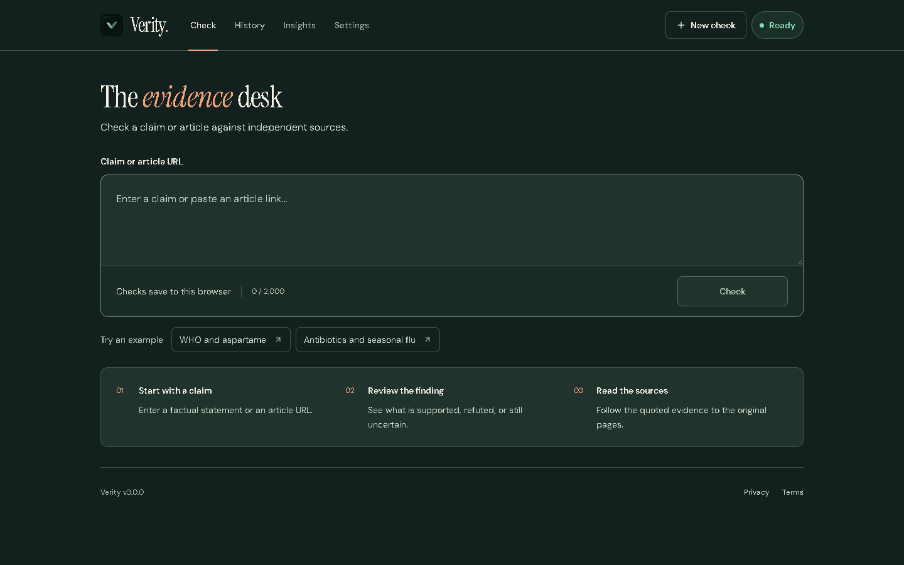

<div align="center">


# Verity

**Check claims and articles against independent web evidence.**

[](https://verity-nine-lyart.vercel.app)
[](https://github.com/99Ayush/verity/actions/workflows/ci.yml)
[](https://nodejs.org/)
[](LICENSE)

[Live demo](https://verity-nine-lyart.vercel.app) · [Source code](https://github.com/99Ayush/verity) · [Report a bug](https://github.com/99Ayush/verity/issues) · [Request a feature](https://github.com/99Ayush/verity/issues)

</div>



Verity is an evidence-first fact-checking workspace. Paste a claim or a public article URL. Verity retrieves web sources with Tavily, asks Gemini to compare the retrieved evidence with the claim, and returns a finding with **exact quoted excerpts** and links to the original pages.

It does **not** turn “no evidence found” into “false”, and it does **not** invent citations. Every cited source ID and quotation is checked against retrieved content. AI judgments can still be wrong — open the sources and judge their relevance.

**Try it:** <https://verity-nine-lyart.vercel.app>

---

## Why Verity

Most “AI fact-checkers” are confident text generators. Verity is built around a narrower, more defensible contract:

- **Evidence before verdict.** A finding is grounded in retrieved sources, not in model memory.
- **Deterministic abstention.** No usable evidence becomes **Unverified**, never a fabricated true/false.
- **Verbatim citations.** Quoted excerpts must match the retrieved source text.
- **Readable reasoning.** Results lead with evidence and source links, not an uncalibrated confidence score.
- **Private by default.** History stays in the browser; provider keys stay on the server.

## Features

| Area | What you get |
| --- | --- |
| Claim checks | One specific claim, 8–2,000 characters, checked against independent web sources |
| Article checks | Extract a public article, select up to three factual claims, and check each one |
| Findings | Supported, Refuted, Mixed findings, or Unverified — with source excerpts and links |
| Evidence controls | Duplicate and unsafe URLs removed; unknown source IDs and non-matching quotes rejected |
| Local history | Up to 50 reports in `localStorage`, searchable, filterable, exportable to JSON/CSV, importable |
| Activity view | Check volume, citation coverage, verdict distribution, and average latency |
| Accessibility | Keyboard shortcuts, focus-trapped dialogs, skip link, reduced-motion support |
| Extension | Optional Chrome/Edge side panel for checking text or a screen selection |
| Demo mode | Deterministic fixture responses for UI review without provider credentials |

## Quick start

Use **Node.js 22.12 or newer**.

```sh
git clone https://github.com/99Ayush/verity.git
cd verity
npm ci
cp .env.example .env
```

Add your server-side keys to `.env`:

```dotenv
GEMINI_API_KEY=your_gemini_key
TAVILY_API_KEY=your_tavily_key
```

Then run the development servers:

```sh
npm run dev
```

- UI: <http://localhost:5173>
- API: <http://localhost:8080>
- Vite proxies `/api` to the API.

To serve the production build with Node:

```sh
npm run build
npm start
```

- App: <http://localhost:8080>

### No API keys? Use the offline demo

```sh
npm run build
npm run preview:test
```

Open <http://127.0.0.1:18089>. The preview uses controlled provider fixtures and shows a test-data banner. It exercises claim and article results, missing evidence, unreadable articles, provider errors, and cancellation. It does **not** perform live fact checks.

Example fixture inputs: `no evidence for this claim`, `provider unavailable for this claim`, `provider quota for this claim`, `slow check for this claim`.

## Configuration

The server loads `.env` from the repository root, `apps/api`, or `apps/web`. Existing environment variables take precedence.

| Variable | Required | Purpose |
| --- | --- | --- |
| `GEMINI_API_KEY` | Yes (live checks) | Server-side Gemini credential |
| `TAVILY_API_KEY` | Yes (live checks) | Server-side Tavily credential |
| `GEMINI_MODEL` | No | Model override; defaults to `gemini-3.5-flash-lite` |
| `GEMINI_FALLBACK_MODEL` | No | Fallback model for busy/unavailable primary models |
| `PORT` | No | API port; defaults to `8080` |
| `HOST` | No | API bind address; defaults to `127.0.0.1` |
| `ALLOWED_ORIGINS` | No | Comma-separated origins for a separately hosted UI |
| `VITE_API_URL` | No | API origin for a separately hosted UI; omit for same-origin |
| `DEMO_MODE` | No | Use deterministic fixtures instead of live providers |
| `PERSISTENCE_ENABLED` | No | Enable optional server-side persistence |
| `DATABASE_PATH` | No | SQLite path when persistence is enabled |
| `PUBMED_ENABLED` | No | Route health claims to PubMed abstracts |
| `WIKIDATA_ENABLED` | No | Ground named entities through Wikidata |

Never put provider secrets in `VITE_*` variables. Vite exposes those to the browser.

## How it works

```text
Claim / article URL
        │
        ▼
  Normalize + validate
        │
        ├── Article? ──► fetch public text ──► extract factual claims
        │
        ▼
  Tavily evidence search  ◄── publisher excluded from its own article checks
        │
        ▼
  Fetch + clean source text
        │
        ▼
  Gemini compares evidence with claim
        │
        ▼
  Validate citations + quotes against retrieved sources
        │
        ├── valid ──► Supported / Refuted / Mixed / Unverified
        └── invalid ──► repair once, then abstain
```

Key guarantees:

- Source IDs and quotations are validated against the retrieved corpus.
- Invalid model output gets one repair attempt against the same sources.
- Provider outages, quota failures, and timeouts return explicit retryable errors.
- Opinions and unresolved predictions remain **Unverified**.
- No numeric confidence is claimed.

## Project structure

```text
apps/
  api/                 Express + TypeScript API
  web/                 React + Vite evidence desk
  extension/           Optional Chrome/Edge extension
packages/
  shared/              Shared Zod schemas, types, and contracts
scripts/               Dev, demo, build, benchmark, and test helpers
eval/                  FEVER-derived validation dataset and validator
tests/e2e/             Playwright browser tests
docs/                  Architecture decisions and dependency notes
api/index.js           Vercel serverless adapter
```

The frontend is intentionally small:

```text
apps/web/src/
  app.tsx              App shell and check orchestration
  dashboard.tsx        Navigation, claim composer, and layout
  result.tsx           Finding and source evidence view
  settings.tsx         Appearance, providers, extension, privacy
  components/
    ui.tsx             Shared badges, toasts, skeletons, artwork
    commands.tsx       Command palette and keyboard help
    history-view.tsx   Saved findings, filters, import/export
    insights-view.tsx  Activity and verdict distribution
  hooks.ts             Toasts, appearance, and modal focus management
  types.ts             View models, verdict labels, provider catalog
  api.ts               Typed API client and SSE progress stream
  storage.ts           Browser history, JSON/CSV import/export
  styles.css           Design tokens, fonts, reset
  dashboard.css        Shell and workspace styles
  polish.css           Motion, dialogs, toasts, responsive polish
  product.css          Result, history, and insights styles
```

## API

| Method | Endpoint | Behavior |
| --- | --- | --- |
| `GET` | `/api/health` | Configuration readiness |
| `POST` | `/api/analyze-claim` | JSON body with `text` or `pageUrl` |
| `POST` | `/api/v1/checks/stream` | Server-sent progress events followed by a result |
| `POST` | `/api/v1/articles/claims` | Extract editable claims from a public article |
| `POST` | `/api/extract-screen` | PNG/JPEG data URL; returns visible text and claims |
| `GET` | `/api/history` | Compatibility endpoint; private history stays in the browser |

Legacy `/health`, `/analyze-claim`, and `/history` paths remain available. API responses use `Cache-Control: no-store`.

```json
{ "text": "Lightning never strikes the same place twice." }
```

A report contains the input, verdict, summary, per-claim findings, source count, timestamps, latency, model, and provider warnings. Each claim contains its verdict, explanation, evidence strength, exact quoted evidence, and retrieved source metadata.

## Verification

```sh
npm run check        # typecheck + Node tests + lint + production build
npm run eval:validate
npm audit
npm run e2e          # needs a Playwright Chromium kernel
```

- **114 Node tests** cover HTTP routes, validation, provider outages, evidence grounding, article extraction, private history, rate limiting, corrupted browser storage, and the extension.
- **`npm run eval:validate`** checks the 130-case FEVER-derived dataset and its recorded provenance offline. It does not measure accuracy.
- **Playwright specs** cover the fixture UI, cancellation, recovery, export/import, keyboard shortcuts, and responsive layout.
- **GitHub Actions** runs a `check` job and an `e2e` job on pull requests and `main`.

## Deployment

### Vercel

Connect the repository to a Vercel project. Both the **repository root** and **`apps/web`** work as project roots; their `vercel.json` files build the Vite UI and route API requests to the same serverless Express handler.

1. Add `GEMINI_API_KEY` and `TAVILY_API_KEY` as server-side environment variables for Preview and Production.
2. Use the Vite framework preset and Node 22 or newer.
3. Root deployments output to `apps/web/dist`; `apps/web` deployments output to `dist`.
4. Redeploy after changing environment variables.
5. Verify `/api/health` and submit a real claim. A `ready` health response confirms configuration presence, not provider quota.

### Docker

```sh
docker compose up --build
```

The app listens on <http://127.0.0.1:8080>. Demo mode is enabled by default. Set `DEMO_MODE=false` and provide provider keys for live checks. Optional Postgres persistence is available through the `postgres` profile.

## Browser extension

Settings includes a downloadable extension ZIP. Build and load it with:

```sh
npm run extension:build
```

Extract `apps/web/public/verity-extension.zip`, then use **Load unpacked** in `chrome://extensions` or `edge://extensions`. You can also load `apps/extension` directly during development.

Click the toolbar icon, choose **Search on screen**, and drag over a claim. Releasing the mouse crops the selection, extracts the claim, fills the field, and starts checking. Selected text and the right-click menu are also supported. The extension stores up to 20 text reports locally and never stores screenshots.

Public one-click installation requires a Chrome Web Store or Edge Add-ons listing. The current ZIP supports development installation.

## Privacy and safety

- **Local history:** up to 50 validated reports in this browser’s `localStorage`. No account, no cross-device sync.
- **Provider processing:** claim text and extracted article text are sent to Tavily and Gemini for analysis.
- **No global server history:** submitted text and API keys are not logged by default.
- **Server-side keys:** provider credentials never reach the frontend or extension.
- **Network safety:** same-origin API access by default, bounded JSON input, public-domain URL validation, pinned public article addresses, redirect checks, and bounded downloads.
- **Rate limits:** 10 checks per minute per IP per function instance. For public traffic, configure shared rate limits, Vercel Firewall, and provider spending limits.
- **Scope:** text and article fact checking, plus visible claim extraction from screenshots. Image authenticity, video, deepfake detection, and emergency coordination are out of scope.

## Design notes

The interface is a dark editorial evidence desk: serif display type, restrained color, generous spacing, and source-first results. It avoids decorative telemetry and uncalibrated percentages. Light and system themes are available in Settings.

The codebase follows a few deliberate rules:

- One compiled TypeScript runtime for local Node and Vercel.
- Shared Zod contracts for every external model/API boundary.
- Browser-local state for private history.
- Small, named modules over framework magic.
- Tests use injected provider fixtures and never require real API keys.

See [ADR-001](docs/ADR-001-evidence-grounding.md), [ADR-002](docs/ADR-002-security-boundaries.md), and [ADR-003](docs/ADR-003-runtime-and-deployment.md) for the reasoning behind the core contracts.

## License

[MIT](LICENSE)
